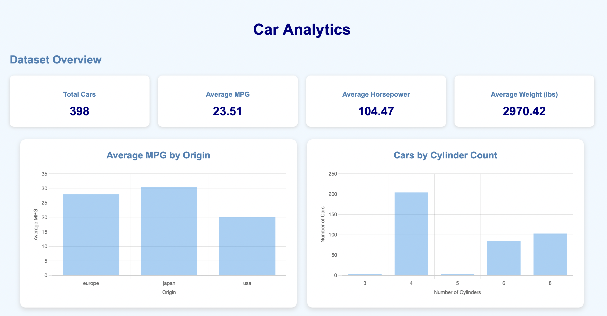
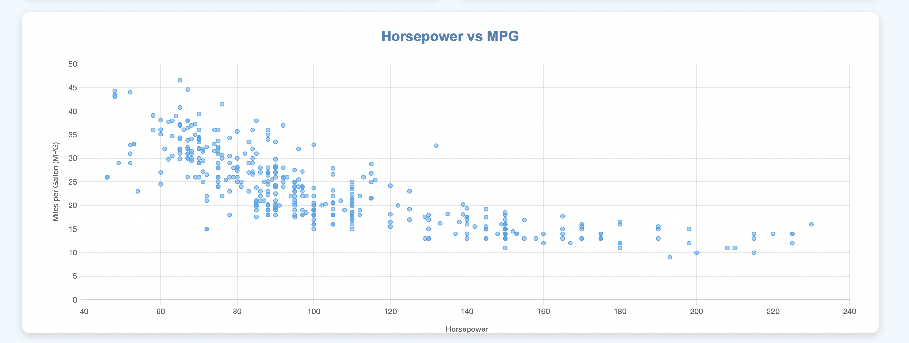
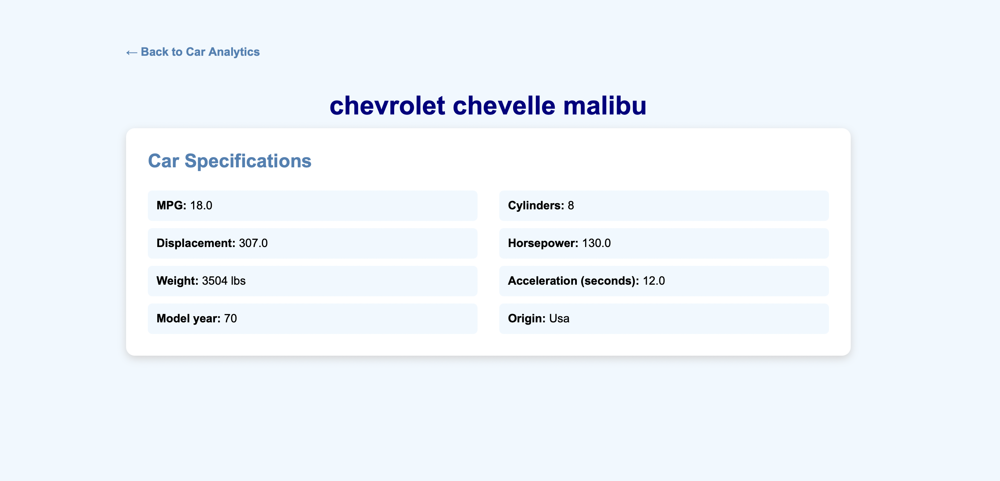
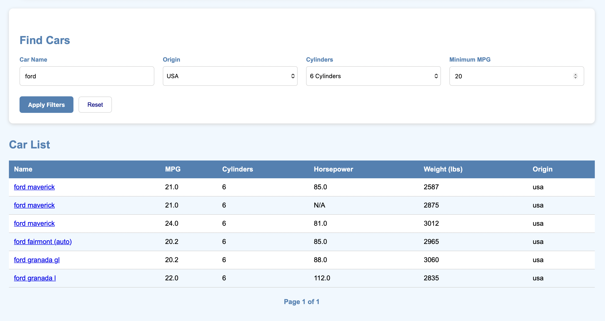

# Car Analytics Dashboard

A full-stack web application built with Django to explore and analyse vehicle fuel economy data.

The application uses the Seaborn MPG dataset and provides interactive dashboards, charts, filtering, pagination, and individual vehicle details.

The project demonstrates the development of a data-driven web application, from database integration and frontend development to Docker containerisation and cloud deployment.

## Live Demo

[View the Car Analytics Dashboard](https://car-analytics-aqgb.onrender.com/cars/)


## Application Screenshots

### Dashboard Overview


### Data Visualisations


### Vehicle Details


### Filtering and Vehicle Records



## Features

- **Interactive Dashboard:** View key vehicle statistics through summary KPI cards.
- **Data Visualisation:** Explore vehicle fuel economy and performance through interactive charts.
- **Dynamic Filtering:** Filter vehicles by name, origin, cylinder count and minimum MPG.
- **Pagination:** Navigate through vehicle records in manageable pages.
- **Vehicle Details:** View individual vehicle information on a dedicated details page.
- **Database Integration:** Store and retrieve vehicle data using PostgreSQL.


## Technology Stack

| Area | Technologies |
|---|---|
| Backend | Python, Django |
| Frontend | HTML, CSS, JavaScript |
| Data Visualisation | Chart.js |
| Database | PostgreSQL, Neon |
| Data Processing | Pandas |
| Containerisation | Docker |
| Deployment | Render |
| Version Control | Git, GitHub |


## Application Architecture

The application follows a Django-based architecture:

1. **Frontend:** Django Templates render the user interface using HTML and CSS.
2. **Application Logic:** Django views handle requests, filtering, pagination and data retrieval.
3. **Database:** Django ORM communicates with the PostgreSQL database hosted on Neon.
4. **Visualisation:** Chart.js displays interactive charts using data supplied by Django.
5. **Deployment:** Docker packages the application, which is deployed to Render.

### Deployment Architecture

User Browser → Render (Django Application) → Neon (PostgreSQL Database)


## Project Structure

```text
car_analytics/
│
├── cars/                   # Main Django application
│   ├── management/         # Custom Django management commands
│   ├── migrations/         # Database migrations
│   ├── static/             # App-specific CSS and JavaScript
│   ├── templates/          # HTML templates
│   ├── models.py           # Database models
│   ├── views.py            # Application logic
│   ├── urls.py             # App URL configuration
│   ├── admin.py            # Django admin configuration
│   └── tests.py            # Application tests
│
├── config/                 # Django project configuration
│   ├── settings.py         # Project settings
│   ├── urls.py             # Main URL configuration
│   ├── asgi.py
│   └── wsgi.py
│
├── data/
│   ├── raw/                # Original dataset
│   └── processed/          # Processed datasets
│
├── notebooks/              # Data exploration and analysis
│
├── staticfiles/            # Collected static files
├── .dockerignore           # Docker build exclusions
├── .gitignore              # Git exclusions
├── Dockerfile              # Docker configuration
├── manage.py               # Django management utility
├── requirements.txt        # Python dependencies
└── README.md
```


## Installation and Setup

### 1. Clone the repository

```bash
git clone https://github.com/pheko49/car_analytics.git
cd car_analytics
```

### 2. Create a virtual environment

```bash
python -m venv .venv
```

Activate it:

**Mac/Linux:**
```bash
source .venv/bin/activate
```

**Windows:**
```bash
.venv\Scripts\activate
```

### 3. Install dependencies

```bash
pip install -r requirements.txt
```

### 4. Configure environment variables

Create a `.env` file in the project root and configure the required settings:

```env
SECRET_KEY=your-secret-key
DEBUG=True
DATABASE_URL=your-database-url
ALLOWED_HOSTS=localhost,127.0.0.1
CSRF_TRUSTED_ORIGINS=http://localhost:8000
```

### 5. Apply database migrations

```bash
python manage.py migrate
```

### 6. Import the vehicle dataset

Import the MPG dataset from `data/raw/mpg.csv` into the database:

```bash
python manage.py import_cars
```

### 7. Start the development server

```bash
python manage.py runserver
```

Open the application at:

http://127.0.0.1:8000/cars/


## Docker Deployment

The application is containerised using Docker to provide a consistent runtime environment.

### Build the Docker image

```bash
docker build -t car-analytics .
```

### Run the Docker container

```bash
docker run -p 8000:8000 --env-file .env car-analytics
```

The application will be accessible at:

http://localhost:8000/cars/


## Dataset

This project uses the **Auto MPG dataset**, which contains information about vehicle fuel economy and technical specifications.

The dataset includes:
- Miles per gallon (MPG)
- Number of cylinders
- Engine displacement
- Horsepower
- Vehicle weight
- Acceleration
- Model year
- Country of origin
- Vehicle name

The original dataset is stored in `data/raw/mpg.csv` and imported into PostgreSQL using a custom Django management command.


## Future Improvements

Potential enhancements for future development include:

- Add automated tests for application functionality.
- Implement additional vehicle performance comparisons.
- Introduce more advanced filtering and search capabilities.
- Improve dashboard responsiveness and user experience.
- Add user authentication and personalised features.
